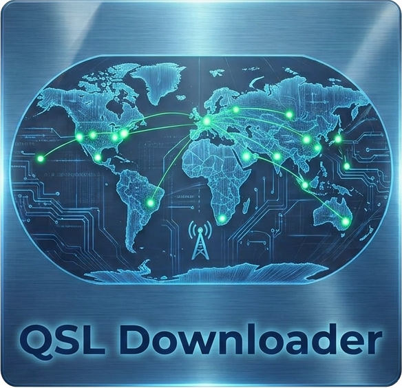
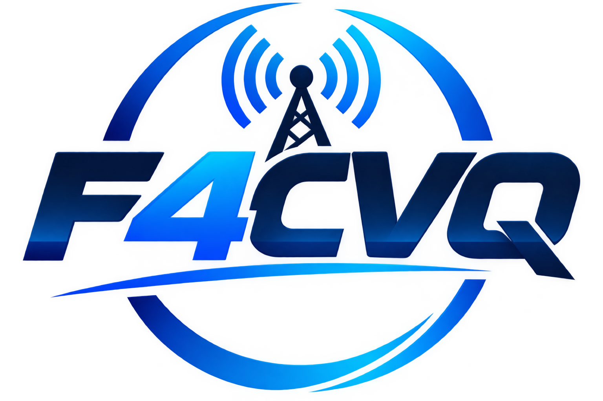

# QSL Downloader – F4CVQ

Application Android qui regroupe vos confirmations QSL de
**eQSL, LoTW, Club Log, QRZ.com, HamLog et HRDLog**.

## Télécharger

👉 **[Dernière version (APK)](https://github.com/F4CVQ/QSL-Downloader/releases/latest)**

Téléchargez `QSL-Downloader.apk`, ouvrez-le sur votre téléphone Android (64 bits) et autorisez l’installation
depuis cette source si Android le demande.

L’application vous prévient au démarrage quand une nouvelle version est disponible.

> **Vous avez la version 1.0.0 ou 1.0.1 ?** Elles étaient signées avec une clé de test : désinstallez-les
> une fois avant d’installer la 1.1.0, puis ressaisissez vos identifiants. Les versions suivantes
> s’installeront normalement par-dessus.

## Fonctions

- **Nouvelles confirmations** depuis votre dernière visite, ou toutes, avec le nom de l’entité DXCC
- **Filtres** par site (un ou plusieurs), bande et mode (CW / phonie / numérique)
- **Carte QSL** de chaque confirmation, avec le **drapeau du pays DXCC**, à enregistrer dans la galerie
  ou à partager ; pour eQSL, la carte originale envoyée par le correspondant
- **Log matching Club Log** : les QSO présents dans le log de vos correspondants (expéditions DX…)
  apparaissent avec le badge **LOG MATCHÉ**, même sans QSL ni LoTW
- **Carte du monde** des confirmations, hors ligne, avec zoom au pincement
- **Diplômes** : avancement DXCC, 5BDXCC, WAS, Triple Play, VUCC, WAZ, WPX, WAC, eDX100, eWAS…
  avec la liste des éléments confirmés et manquants

## Mode d’emploi

### 1. Configurer vos comptes (onglet « Comptes »)
1. Remplissez les identifiants des sites que vous utilisez (voir le tableau ci-dessous).
2. Touchez **Enregistrer et tester** : l’application se connecte et télécharge vos confirmations.
3. En cas de problème, le message d’erreur s’affiche en rouge sous le site concerné.

> **LoTW** : le tout premier téléchargement de votre historique peut prendre plusieurs minutes.
> Patientez sans relancer : LoTW n’accepte qu’une demande à la fois par compte.

Pour **HamLog** ou **HRDLog**, exportez votre carnet au format ADIF depuis le site, puis touchez
**Importer un fichier ADIF** et choisissez le fichier.

### 2. Consulter vos confirmations (onglet « QSL »)
- **Nouvelles** : les confirmations arrivées depuis votre dernière visite ; **Toutes** : l’historique complet.
- Tirez la liste vers le bas pour synchroniser. L’application synchronise aussi à chaque ouverture.
- Le bouton **filtre** permet de choisir un ou plusieurs sites, une bande et un mode.
- Touchez une confirmation pour voir sa **carte QSL** : **Enregistrer l’image** l’ajoute à votre galerie,
  **Partager** l’envoie par message ou e-mail. Pour eQSL, vous pouvez aussi télécharger la carte originale.
- Le badge **LOG MATCHÉ** (Club Log) indique que le correspondant vous a dans son log. Vos QSO les plus récents
  sont vérifiés en premier, puis la vérification se poursuit à chaque synchronisation (l’avancement s’affiche
  sous Club Log dans l’onglet Comptes). Ce n’est pas une confirmation QSL : ces QSO ne comptent pas dans les
  diplômes, sauf l’indicateur « DXCC confirmés + log matching ».

### 3. Carte du monde (onglet « Carte »)
- Chaque point représente un locator (ou un pays DXCC si le locator est inconnu), coloré selon le site.
- **Pincez à deux doigts** ou utilisez **+ / −** pour zoomer, **glissez** pour vous déplacer.
- Touchez un point pour afficher les confirmations correspondantes.

### 4. Diplômes (onglet « Diplômes »)
- Choisissez un site : l’avancement de chaque diplôme s’affiche avec une barre de progression.
- Touchez un diplôme pour voir les éléments **confirmés** et ceux qui **manquent** encore.
- L’avancement est calculé à partir de vos confirmations téléchargées ; il peut différer légèrement des
  chiffres officiels (QSL papier, demandes de crédit en cours…).

Toutes les confirmations déjà reçues restent enregistrées dans le téléphone.

## Identifiants demandés

| Site | Identifiants |
|---|---|
| eQSL | indicatif + mot de passe (+ QTH Nickname si plusieurs comptes) |
| LoTW | identifiant + mot de passe du **site web** LoTW (pas le certificat TQSL) |
| Club Log | e-mail, mot de passe (ou mot de passe d’application), indicatif — aucune clé API à demander |
| QRZ.com | clé API du carnet (abonnement XML Logbook Data nécessaire pour le téléchargement) |
| HamLog / HRDLog | aucun : import d’un export ADIF fait depuis le site |

Vos identifiants restent **chiffrés sur votre téléphone** et ne sont envoyés qu’au site concerné.

## Licence

© 2026 F4CVQ – Tous droits réservés. L’application est diffusée gratuitement ; son code source n’est pas public.
